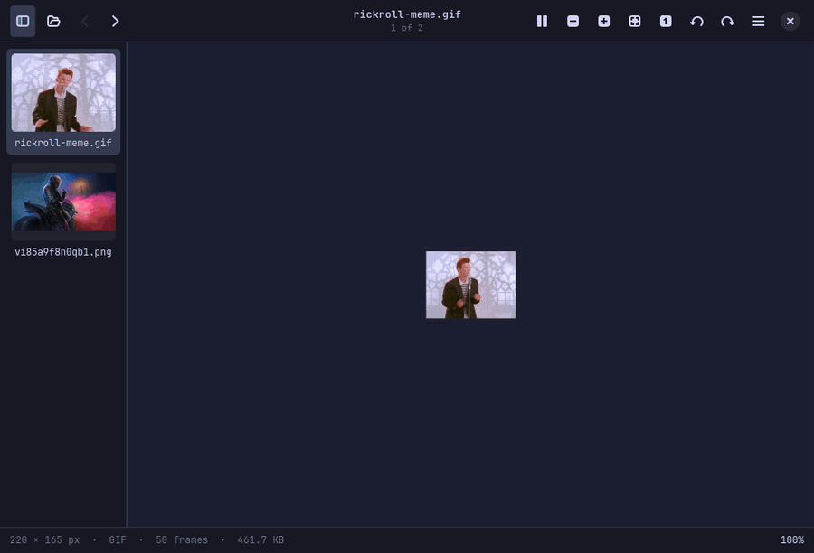

# Previewer

A fast, themeable image viewer for Linux, modelled on macOS Preview. Rust and
GTK4. Its look comes from the same idea as [Strata](https://github.com/lgse/strata):
no libadwaita, just a handful of colour tokens that drive every widget.



## Run

```sh
cargo run --release -- photo.png          # a file, with its folder's images in the sidebar
cargo run --release -- ~/Pictures         # a folder
cargo run --release -- a.png b.jpg c.svg  # exactly these files
cargo run --release                       # empty window; Ctrl+O or drop files on it
```

To install: `cargo install --path .`, then copy
`data/dev.previewer.Previewer.desktop` to `~/.local/share/applications/` so it
shows up in "Open With".

Needs GTK 4.12 or newer. Opening a second file while Previewer is running opens
a new window in the same process.

## Formats

Decoded in-process, on worker threads: PNG, JPEG (with EXIF rotation), GIF,
WebP, BMP, ICO, TIFF, QOI, TGA, PNM, HDR, OpenEXR and SVG/SVGZ (rasterised
large so it stays crisp when zoomed). Animated GIF, APNG and WebP play. The
file's content is sniffed, so a wrongly named file still opens.

Anything else (HEIC, AVIF, JPEG XL, ...) is handed to GDK's own loaders, so it
works if your system has them (gdk-pixbuf or glycin).

## Keys and mouse

| Action | Keys |
| --- | --- |
| Open | `Ctrl+O` (or drop files on the window) |
| Next / previous image | `→` `Page Down` / `←` `Page Up` |
| First / last image | `Home` / `End` |
| Zoom in / out | `+` / `-` (also with `Ctrl`), `Ctrl` + wheel, pinch |
| Zoom to fit | `0` |
| Actual size (100%) | `1` |
| Rotate left / right | `Ctrl+L` / `Ctrl+R` |
| Play / pause animation | `Space` |
| Copy image | `Ctrl+C` |
| Toggle sidebar | `F9`, `Ctrl+B` |
| Full screen | `F11`, `F` (`Esc` leaves) |
| Close window / quit | `Ctrl+W` / `Ctrl+Q` |

Drag to pan once zoomed in. Double-click toggles between fit and 100%. The
wheel pans; set `scroll_zooms: true` to make it zoom instead. 100% means one
image pixel per screen pixel, including on HiDPI and fractionally scaled
displays.

## Settings

`~/.config/previewer/settings.yml` is created on first run, with comments. It
is watched, so edits apply live.

| Key | Default | |
| --- | --- | --- |
| `theme` | `"system"` | `"system"`, a built-in id, or a file name in `themes/` |
| `corner_roundness` | `30` | 0 square, 100 very round |
| `text_size` | `13` | interface text, in pixels |
| `interface_font` | unset | font family |
| `scroll_zooms` | `false` | wheel zooms instead of pans |
| `checkerboard` | `true` | show a checkerboard behind transparency |
| `show_sidebar` | `true` | thumbnail sidebar on open |
| `reduce_motion` | `false` | turn off animations |

## Theming

The menu (top right) lists every theme; picking one rewrites only the `theme`
line of `settings.yml`.

**Built in:** Catppuccin (Mocha, Macchiato, Frappe, Latte), Tokyo Night,
Gruvbox Dark, Nord, Rosé Pine, Dracula. See `data/themes.yml`.

**System** follows the `@define-color` values in `~/.config/gtk-4.0/gtk.css`
(and anything it `@import`s). Tools like Noctalia and matugen write their
palette there, so Previewer recolours live when your wallpaper theme changes.

**Your own:** drop a YAML file in `~/.config/previewer/themes/`; the file name
(minus `.yml` or `.yaml`) is the theme id. Only three colours are required, the rest are
derived:

```yaml
name: "Sunset"            # optional
background: "#2b1b17"
text: "#ffe8d6"
accent: "#ff7b54"

# optional, derived from the above when left out:
# surface: "#..."         header bar, sidebar, status bar, menus
# danger: "#..."          errors
# muted: "#..."           disabled and subtle fills
# highlight: "#..."       hover and selected fills
# border: "#..."          hairlines
# dim_text: "#..."        secondary text
```

Colours must be hex (`#rgb` or `#rrggbb`). A broken theme file is reported on
stderr and Previewer falls back to the default theme.

**Anything else:** `~/.config/previewer/style.css` is loaded last and wins over
everything. Use the tokens as `@pv_bg`, `@pv_surface`, `@pv_text`,
`@pv_accent`, `@pv_danger`, `@pv_muted`, `@pv_highlight`, `@pv_border` and
`@pv_dim_text`:

```css
.status-bar { background: @pv_bg; }
button.pv-button:hover { background: alpha(@pv_accent, 0.3); }
```

Useful hooks: `.pv-header`, `button.pv-button`, `.sidebar`, `.thumb`,
`.thumb-name`, `.stage`, `.status-bar`, `.pv-popover`, `.menu-item`. See
`src/style.css` for the rest.

## Layout of the code

| File | |
| --- | --- |
| `src/theme.rs` | tokens, built-in/custom/system themes, CSS generation, live reload |
| `src/style.css` | the stylesheet, written only in terms of tokens |
| `src/canvas.rs` | zoom/pan/rotate widget, plus the tested view maths in `canvas::geometry` |
| `src/decode.rs` | file to pixels, off the main thread |
| `src/library.rs` | which images a window steps through, natural sort |
| `src/window.rs` | header bar, sidebar, status bar, actions, menu |
| `src/settings.rs` | `settings.yml` |
| `src/debug.rs` | developer screenshot hook, see below |

`cargo test` runs the unit tests (they need no display).

## Not done yet

- Animations (GIF, APNG, WebP) loop forever at their own frame timing; the
  file's loop count is ignored, and there is no frame stepping or scrubbing.
  Very large animations are decoded on the fly and so show no frame count.
- Rotation is a view setting; it is not saved back to the file.
- No annotation or markup, and no PDF.
- Sidebar thumbnails are generated for the built-in formats only; formats that
  go through GDK's loaders open fine but show a blank thumbnail.
- Vector images are rasterised once, not re-rendered as you zoom.

## Developer aid

`PREVIEWER_RECORD=dir` records numbered PNG frames of the window instead
(`PREVIEWER_RECORD_MS`, `PREVIEWER_FPS`, and `PREVIEWER_SCRIPT` such as
`1500:zoom-in,6000:next,11500:theme=nord` to drive it); `docs/demo.gif` was
made that way, with the frames stitched together by ffmpeg.

Renders the window to a PNG and quits, which is handy for checking a theme
without a screenshot tool:

```sh
PREVIEWER_SCREENSHOT=/tmp/shot.png previewer photo.png
PREVIEWER_SCREENSHOT_MENU=1 PREVIEWER_SCREENSHOT=/tmp/shot.png previewer photo.png   # also /tmp/shot.menu.png
PREVIEWER_ACTIONS=zoom-in,rotate-right,next PREVIEWER_SCREENSHOT=/tmp/shot.png previewer photo.png
```

Set `XDG_CONFIG_HOME` to a scratch directory (symlinking `gtk-4.0` into it if
you want the system theme) to keep experiments out of your real settings.
